# job-hunter

<p align="center">
  
</p>

The diagram runs on a 14-second loop. A posting card travels round the ring
from Scout to Operations and turns into a resume at the Writer. Each role
drops its output into a file in your workspace, and the `pipeline.md` stage
lights up as the application moves along. For the full 13-step 3D
walkthrough, open [`docs/workflow.html`](docs/workflow.html) in a browser
from a clone. GitHub shows that file as source, and the page loads three.js
from unpkg, so it needs an internet connection.

job-hunter is a Claude skill that acts as a job-search agent and career coach
for tech and other white-collar roles. Malaysia and Singapore come first
(JobStreet, MyCareersFuture, LinkedIn, local salary and notice norms); other
countries use a per-market template. It runs as a Claude Code plugin: your
profile, pipeline and contacts are markdown files in `~/job-hunt` by default,
and bundled Python scripts search the boards, fetch postings, track
applications, build resume files and check them. It reads your profile before
it answers, asks only about gaps, and drafts only from facts in that profile
(`references/facts-policy.md`). Every request goes to one of nine roles:

| # | Role | What it does | Try saying | Claude Code verb |
|---|---|---|---|---|
| 1 | Strategist | Target roles, positioning, career map, cadence and runway | "What roles should I aim for?" | (plain English) |
| 2 | Scout | Fresh openings from the boards, daily digest, shortlist | "Find me fresh openings this week" | `/job-hunter:search [rank] [--days N]` |
| 3 | Qualifier | Knockout check, legitimacy check, fit score, apply / stretch / skip | "Am I a fit for this?" + posting | `/job-hunter:match <posting>` |
| 4 | Writer | Resume tailor or revamp, HR-eye score, cover letter, screening answers | "Tailor my resume for this posting" | `/job-hunter:resume [tailor\|revamp\|score\|cover]` |
| 5 | Networker | Referral map before applying, outreach, contacts CRM | "Who can refer me at Grab?" | (plain English) |
| 6 | Coach | Interview prep pack, mock interview, debrief, company dossier, soft skills | "Mock interview me for Friday" | `/job-hunter:interview [mock\|debrief\|company <name>]` |
| 7 | Negotiator | True annual comp, offer comparison, negotiation | "I got an offer — should I take it?" | `/job-hunter:offer` |
| 8 | Operations | Today view, weekly funnel review, stale and silent applications | "What should I do today?" | `/job-hunter:today [week] [YYYY-MM-DD]` |
| 9 | Onboarder | Resignation, notice, references, background check, 30-60-90 plan | "I accepted — what now?" | (plain English) |

Those six verbs are the whole command surface. Strategist, Networker and
Onboarder work in plain English: ask in a sentence and the same role answers.

## Install — Claude Code

Needs Claude Code, `git`, and Python 3.10 or later (or `uv`, which the launcher uses when no working Python is found).

```sh
claude plugin marketplace add cincaoais/job-hunter
claude plugin install job-hunter@job-hunter
```

Start a new session afterwards. The repository `cincaoais/job-hunter` is
private: you need read access to it on GitHub, and Claude Code clones it with
`git` using the credentials already on your machine (it never prompts).

- The `owner/repo` shorthand tries SSH first and falls back to HTTPS. To use
  SSH explicitly, add the marketplace by its SSH URL:

  ```sh
  claude plugin marketplace add git@github.com:cincaoais/job-hunter.git
  ```

  SSH needs a key that works without a passphrase prompt (for example one
  loaded in `ssh-agent`) and github.com in `known_hosts`.
- HTTPS needs a stored credential: `gh auth login`, then `gh auth setup-git`.
  On a machine without a GitHub SSH key, set
  `CLAUDE_CODE_PLUGIN_PREFER_HTTPS=1` to skip the SSH attempt.

Updates: `claude plugin marketplace update job-hunter`, then
`claude plugin update job-hunter@job-hunter` and restart; or turn on
auto-update for the marketplace under **Marketplaces** in `/plugin`. An
installed copy changes only when the plugin's `version` changes.

**From a clone** (for working on the skill itself):

```sh
git clone git@github.com:cincaoais/job-hunter.git
cd job-hunter
python build.py
```

`python build.py` validates the skill files; it is the same as
`python build.py --check`. The scripts run through
`sh skills/job-hunting/scripts/jh <script>.py …`, a small POSIX-sh launcher;
its Python detection is described under [Windows](#windows).

## First run

In Claude Code:

1. `/job-hunter:today` — runs `tracker.py today`. With no workspace yet it
   prints `No workspace found — run: sh …/jh workspace.py init`; say yes
   when Claude offers to run it. From a clone you can run it yourself:

   ```sh
   sh skills/job-hunting/scripts/jh workspace.py init
   ```

   The installed plugin keeps the launcher and its copy of the scripts under
   `~/.claude/plugins/cache/job-hunter/job-hunter/<version>/skills/job-hunting/scripts/`;
   the commands use that path for you.
2. Give it your resume (paste it or name the file) and say what you are
   looking for. It fills `profile.md` from the resume first, then asks one
   grouped batch of questions about what is missing.

`sh skills/job-hunting/scripts/jh workspace.py where` prints the workspace it
will use: `$JOB_HUNT_DIR` if set, else `./job-hunt/` if that folder exists in
the current directory, else `~/job-hunt`. `init` creates only what is missing
and never overwrites:

| Path | Holds |
|---|---|
| `profile.md` | Snapshot, targets and search criteria (§1–§3 feed `search_jobs.py`), skills, experience, positioning, weekly cap |
| `pipeline.md` | One row per company and role: source, channel, stage, next action, due date, resume sent; an Offers table |
| `contacts.md` | Networking CRM: relationship, last touch, next touch, status |
| `answers.md` | Screening answers (salary, notice, work authorization, …), STAR stories, references |
| `seen-jobs.json` | Postings already shown, so each search lists only new ones |
| `postings/` | Saved postings (`fetch_posting.py --save`) |
| `resumes/`, `letters/` | Versioned resume and cover-letter drafts and the built files |
| `dossiers/` | Company briefs |
| `reviews/` | Weekly review files (`tracker.py digest`) |
| `interviews/` | Prep packs, mock scorecards and debriefs per pipeline row, written by `interview.py` (every file carries `contract: 1`), plus a generated `question-bank.md` |

Each workspace session ends with one `saved: …` line naming the files and
sections it changed.

## Scripts

In `skills/job-hunting/scripts/`, all run through the `jh` launcher. The core
uses only the Python standard library. A missing optional package is named in
the output and the script carries on without it, except a PDF check with no
extractor, which exits 2. Each script prints its usage with `--help`. The
skills run them for you.

| Script | What it does | Optional extras |
|---|---|---|
| `workspace.py` | `init` creates the workspace from the templates; `where` prints the resolved path | — |
| `search_jobs.py` | Searches JobStreet (MY/SG), MyCareersFuture (SG) and LinkedIn guest search with the profile's criteria (flags override: `--keywords --location --country --days --salary-min --sources --pages --all --no-seen`), drops seen postings and knockouts, ranks by freshness; `--markdown` or `--json` | — |
| `fetch_posting.py` | A posting URL, JobStreet id or MyCareersFuture uuid → markdown in `postings/<slug>.md` (`--save`); `--stdin` takes pasted text; exit 3 when the page is blocked by a bot challenge, and exit 4 with `not found: …` when the job is gone or `unavailable: …` when the board did not answer | `cloakbrowser` (pages behind a bot challenge) |
| `tracker.py` | `add`, `set` (pipeline rows), `today`, `funnel`, `digest` (writes `reviews/<date>.md`), `contacts` (touches due), `contact` (upsert a contact); `--today YYYY-MM-DD` overrides the date. Read commands exit 0 even with no workspace; a write command with no workspace exits 2 | — |
| `interview.py` | `new`, `outcome` (prep, mock and debrief files per pipeline row; every file carries `contract: 1`), `bank` (rebuilds `interviews/question-bank.md`); a write with no workspace or no matching pipeline row exits 2 | — |
| `build_resume.py` | Resume markdown → ATS `.docx` (`--docx`, standard library only), presentation `--html`/`--pdf` from five templates (`--template chicago`, `executive`, `corporate-sidebar`, `accent-band`, `creative-sidebar`), JSON Resume (`--json`) | `playwright` with Chromium for `--pdf`, else `cloakbrowser`; with neither it writes the `.html` and prints "PDF skipped" |
| `ats_check.py` | What a parser reads from a `.docx`, `.pdf`, `.md` or `.txt`: keyword coverage (`--posting` or `--keywords`), 6-second lint (`--lint`, `--target-title`), banned-phrase scan (`--slop`), extracted text (`--text`), `--json` | `pypdf` or poppler's `pdftotext` for PDFs; with neither, a PDF check exits 2 and says so |

Optional installs:

```sh
python -m pip install certifi         # TLS on python.org Python for macOS
python -m pip install cloakbrowser    # blocked posting pages; PDF fallback
python -m pip install playwright && python -m playwright install chromium   # PDF rendering
python -m pip install pypdf           # PDF text for ats_check.py (or install poppler for pdftotext)
```

On Python from python.org's macOS installer, board requests fail with
`CERTIFICATE_VERIFY_FAILED` until you run
`/Applications/Python 3.x/Install Certificates.command` or install
`certifi`, which the scripts use when present. They never turn TLS
verification off.

## The daily and weekly loop

| When | Run | What happens |
|---|---|---|
| Daily | `/job-hunter:today` | Overdue and due follow-ups, interviews this week, stale rows, auto-cold candidates, contacts due; Claude drafts the follow-ups and asks before marking a row cold |
| Daily | `/job-hunter:search [--days N]` | New postings only (`--days 2` for the daily digest), knockouts applied, fit reasoning and a referral path per row |
| Daily | `/job-hunter:search rank` | Batch-triage the unseen backlog into a ranked shortlist: every posting fetched, knockout pre-check, fit score, deal-breaker vetoes; pick a row and `/job-hunter:match` runs in full |
| Per posting | `/job-hunter:match <posting>` | Saves the posting, runs the knockout pre-check, legitimacy check and fit score, gives an apply / stretch / skip verdict |
| Before applying | "Who can refer me at <company>?" (plain English, Networker) | Referral map (people searches as LinkedIn links), one outreach message, the touch logged in `contacts.md` |
| To apply | `/job-hunter:resume tailor <posting>`, `/job-hunter:resume cover <company and role>` | Resume: inline draft, then on approval a claims audit, banned-phrase scan and 6-second lint, `build_resume.py` and `ats_check.py`; the resume sent is recorded on the pipeline row. Cover letter: saved, claims-audited and scanned before you see it |
| Weekly | `/job-hunter:today week` | Sent → response → interview → offer by channel and source, the first leaking stage, one change for next week; writes `reviews/<date>.md` |
| As they come | `/job-hunter:interview [mock\|debrief]`, `/job-hunter:interview company <name>`, `/job-hunter:offer`, "I accepted — what now?" | Prep pack or mock, company dossier, offer read, post-offer steps |

Referral comes before application because a referral turns a ~3% cold
application into a ~40% interview chance (Ashby, 38M applications, 2025/26).
The weekly application cap and outreach target live in profile §8. For a
recurring digest, run `/loop 1d /job-hunter:search` in Claude Code.

## Windows

The scripts run through `sh skills/job-hunting/scripts/jh <script>.py …`. The
`jh` launcher picks the first working Python 3.10+ — `python3`, then
`python`, then `py -3` — and falls back to `uv run` when none of them starts.
A Windows Store `python` alias that exists but cannot start fails the version
probe and is skipped, so `jh` moves on to the next candidate. Run it from Git
Bash or another shell that provides `sh`.

- The default workspace is `$env:USERPROFILE\job-hunt`; to put it elsewhere,
  set `$env:JOB_HUNT_DIR = "D:\job-hunt"` for the session or
  `setx JOB_HUNT_DIR D:\job-hunt` for new shells.
- `.gitattributes` keeps `.py`, `.md`, `.html`, `.json` and `.yml` files LF,
  and the tests check that the checkout has no CRLF.

## Layout

| Path | What it is |
|---|---|
| `.claude-plugin/plugin.json` | Plugin manifest: name `job-hunter`, version |
| `.claude-plugin/marketplace.json` | The marketplace that lists the plugin, so `claude plugin marketplace add` works on this repo |
| `skills/job-hunting/SKILL.md` | The main skill: workspace setup, memory rules, the nine-role router, principles |
| `skills/job-hunting/references/` | One file per role or flow (including `interview-debrief.md`); `markets/` holds `my.md`, `sg.md` and `_template.md` for other countries |
| `skills/job-hunting/scripts/` | The scripts and their `jh` launcher, `_common.py`, and `sources/` (one module per board) |
| `skills/job-hunting/assets/` | Workspace and profile templates, `interview-*-template.md`, five resume HTML templates, `slop-phrases.txt` |
| `skills/<verb>/SKILL.md` | The six command skills: `interview`, `match`, `offer`, `resume`, `search`, `today` |
| `build.py` | Validates the skill files (`--check`, which is also the default action) |
| `tests/` | pytest suites, `fixtures/` (including recorded board responses), `behavioral-scenarios.md` |
| `docs/backlog.md` | Open follow-up items carried over into this version |
| `docs/workflow.svg` | The animated diagram at the top of this README (no scripts; SVG/CSS animation only) |
| `docs/workflow.html` | Interactive three.js walkthrough of the whole workflow in 13 steps; open it in a browser |
| `.github/workflows/ci.yml` | Tests and `build.py` on Ubuntu and Windows |

## Development

```sh
python -m pip install pytest
python -m pytest -q                     # offline suite, as CI runs it
python -m pytest -q -m network          # live: a JobStreet search, a MyCareersFuture search, a JobStreet posting fetch
python build.py                         # validates the skills (same as --check)
claude plugin validate .                # plugin and marketplace manifests
```

`pytest.ini` excludes the three live network tests by default; `-m network`
runs them.

The skill's content lives only under `skills/`. To release, set the same
version in `.claude-plugin/plugin.json`, the entry in
`.claude-plugin/marketplace.json` and `metadata.version` in
`skills/job-hunting/SKILL.md` — `tests/test_build.py` checks that the three
agree — and merge to `main`, the default branch. CI runs the tests and
`python build.py` on Ubuntu and Windows.

Behaviour tests: [`tests/behavioral-scenarios.md`](tests/behavioral-scenarios.md)
holds scenarios A–U, run as fresh-agent sessions and graded against a
checklist, with results for rounds 1–5. In Round 4 (the v6 workspace-mode
scenarios, 2026-09-27) M, N, O and P passed with minor gaps and Q failed one
checklist item: the references brief was described, not drafted, and the
`withdrawn` tracker commands were promised, not shown. In Round 5 (the
interview scenarios R–U, 2026-10-02) all four passed, R and T with minor gaps,
after one hardening pass.

## What it deliberately does not do

- **Auto-apply bots.** It drafts; you submit. `answers.md` keeps truthful
  screening answers ready to paste instead.
- **Live interview copilots.** Coaching happens before the interview, not
  during it.
- **Logging in to job boards.** The scripts use public board APIs and pages
  only; there is no login automation anywhere.
- **Scraping boards that block bots.** Glassdoor, Glints and NodeFlair are
  not scraped; salary data from them is read through live web search and
  cited.
- **Inventing facts.** No invented metrics, achievements, titles, competing
  offers or constraints. A missing number is asked for, and an estimate you
  supply is labelled as one.